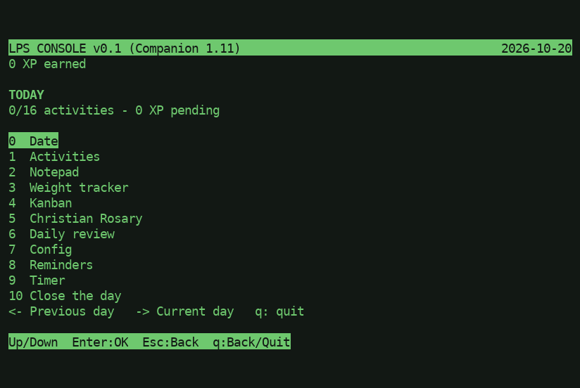

# LifePositioningSystem
LPS - Determine where you are in life

# Setup

## Libraries

```
sudo apt install -y ffmpeg python3-gi gir1.2-gtk-3.0 gir1.2-gst-plugins-base-1.0 gstreamer1.0-plugins-{base,good,bad,ugly} gstreamer1.0-libav gstreamer1.0-gtk3
```

### Extras for Raspberry Pi 4

```
sudo apt install gstreamer1.0-tools
sudo apt install gstreamer1.0-gl gstreamer1.0-gtk3
```

## Keyboard modes

Press **V** while `c18/lps-rpi4.py` is running to toggle Voyage mode. While
enabled, scheduled actions and regular videos are suspended. The application
cycles through the PNG files in
`/home/tme520/Videos/LPS/lps-basepack/slideshow/mystery/` every 10 seconds and
plays the MP3 files in `/home/tme520/Music/LPS/` sequentially. Both lists loop
back to their first item after reaching the end.

# LPS Console (terminal edition of the LPS Companion)

`console/lps-console` is a lightweight, VT100-style terminal edition of
**LPS Companion**, the offline daily journal and activity tracker for the
Clockwork PicoCalc ([LPS-Companion-PicoCalc](https://github.com/TME520/LPS-Companion-PicoCalc)).
It mirrors the Companion's menus, texts, XP rules and limits (v1.11). It is
**keyboard-only; the mouse is not used**. It reads and writes the same
`LPS/EXPORT/*.ics` and `LPS/WEIGHTS/*.csv` files as the Companion.



## Requirements

- Python 3 with the standard library `curses` module (included with Python on Linux).
- No other dependencies and nothing to install.
- A terminal of 80×24 is recommended; the minimum is 40×20. Resizing is handled.

## Launch

```sh
cd console && ./lps-console
```

You can also run `python3 -m lpsconsole` from inside `console/`.

## Command-line options

| Option | Meaning |
|---|---|
| `--data-dir DATA_DIR` | State folder (default: `$XDG_DATA_HOME/lps-console`, i.e. `~/.local/share/lps-console`) |
| `--export-dir EXPORT_DIR` | LPS folder receiving `EXPORT/*.ics` and `WEIGHTS/*.csv` (default: `<data-dir>/LPS`) |
| `--import PATH` | Import a Companion SD card root or `LPS` folder (ICS + weights CSV) before starting |
| `--import-save` | With `--import`, also read `SAVE_A.BIN` / `SAVE_B.BIN` |
| `--no-ui` | Do not start the interface (import and print the report only) |
| `--lang {en,fr}` | Set and save the interface language |

Examples:

```sh
./lps-console --import /media/$USER/PICOCALC                       # import, then open the UI
./lps-console --import /media/$USER/PICOCALC/LPS --import-save --no-ui
./lps-console --export-dir /media/$USER/PICOCALC/LPS               # write exports straight to the SD card
./lps-console --lang fr
```

## Key bindings

### Global keys

| Key | Action |
|---|---|
| Up / Down | Move the selection |
| Enter | Open or confirm |
| Esc or `q` | Go back. In text fields (note, task name, reminder, import path), `q` is an ordinary letter |
| `q` on Home | Quit |

### Keys per screen

| Screen | Keys |
|---|---|
| **Home** | `0` Date, `1` Activities, `2` Notepad, `3` Weight tracker, `4` Kanban, `5` Christian Rosary, `6` Daily review, `7` Config, `8` Reminders, `9` Timer. **10 Close the day**: arrows + Enter (Up from item 0). **Left** steps back through the last 31 closed days (read-only: only items 1-3 open). **Right** returns to today. |
| **Date** | Type `YYYY-MM-DD` (2000-01-01 to 2099-12-31). Backspace edits, Enter saves. |
| **Activities** | 16 checkboxes on 2 pages (10 + 6). Up/Down selects, Enter or Space toggles, `1`-`9` toggle activities 1-9 directly, Left/Right change page. |
| **Notepad** | Type up to 96 printable ASCII characters. Backspace erases, Enter saves, Esc cancels. |
| **Weight tracker** | Expected and actual weight in kg (dot or comma, up to 3 decimals). Leave a field blank if not recorded. Up/Down/Tab switch field, Enter saves. |
| **Kanban** (24 tasks, 32 chars) | Left/Right: column TODO / DOING / DONE. Up/Down: task. `N`: new task. Enter: rename. Del or `x`: delete. F1/F2/F3 or `1`/`2`/`3`: move to TODO/DOING/DONE. F4 or `-`: move up. F5 or `+`: move down. |
| **Christian Rosary** | Mode `1`-`4` (one decade, full, Scripture + guidance, slow contemplation). Then mysteries `1` (today's) or `2`-`5`. In one-decade mode, mystery `1`-`5`. During prayer: Enter, Right or Space advance; Left goes back; Esc leaves. |
| **Daily review** | Up/Down scroll one line, Left/Right scroll eight lines. |
| **Config** | `1` Language (Up/Down or `1`/`2`, then Enter), `2` Colors (Up/Down or `1`-`5` previews PAL1-PAL5, Enter saves), `3` Save (applies the language), `4` Import from Companion SD. |
| **Import** | Type the path to the SD card root or `LPS` folder. Tab toggles reading `SAVE_A/B.BIN`. Enter imports, then Enter returns Home. |
| **Reminders** (max 3) | `N`: new. Enter: edit. Del: delete. In the editor, Up/Down/Tab move between From (`YYYY-MM-DD`), Days (1-365) and Text (32 chars); Enter saves. Active reminders pop up at startup (any key dismisses). |
| **Timer** | Up/Down then Enter: 5, 15 or 30 minutes. Enter pauses/resumes, Esc cancels. Turns red under 01:00. At zero, Enter starts again. |
| **Close the day** | Shows activities, variety bonus and XP. Enter saves, exports the ICS and weights CSV, banks the XP and advances to the next date. New keepsakes are announced next. |

XP rules: 10 XP per checked activity, plus 10 bonus XP for 3 or more. Keepsakes
unlock at 30, 70, 120, 180, 250 and 330 total XP.

## Where data is stored

| What | Location |
|---|---|
| State (JSON, atomic writes, previous version kept as `state.json.bak`) | `~/.local/share/lps-console/state.json` (or `$XDG_DATA_HOME/lps-console/`, or `--data-dir`) |
| Day exports (one per closed day) | `<data-dir>/LPS/EXPORT/YYYY-MM-DD_LPS-Companion.ics` |
| Weights journal | `<data-dir>/LPS/WEIGHTS/YYYY.csv` (`date,expected_kg,measured_kg`) |

Use `--export-dir` to write exports elsewhere. These files are byte-identical
to the Companion's own exports, so the two are interchangeable.

## Importing from a PicoCalc SD card

Mount the card, then either run `./lps-console --import /path/to/card`
(optionally with `--import-save`) or use **Config → 4 Import** in the
interface. The path may be the card root (containing `LPS/`) or the `LPS`
folder itself.

- `EXPORT/*.ics`: each day not already closed locally is added as a closed
  day, and its XP (recomputed with the Companion rules) is added to the total.
- `WEIGHTS/*.csv`: rows fill the weights journal and complete missing weights
  of closed days.
- `SAVE_A.BIN` / `SAVE_B.BIN` (optional, read-only, formats 1-6): the newest
  valid snapshot's dated history is merged. Kanban tasks and reminders are
  copied only if they are empty locally.

Merging is by date with no duplicates, and local data always wins. Nothing is
written to the card unless you point `--export-dir` at it.

## Running the tests

```sh
cd console && python3 -m unittest discover -s tests -t .
```

The fixtures in `console/tests/fixtures/` were produced by the real Companion
firmware code (see `console/tests/fixtures/README.md`).

## Reuse from other LPS programs

`console/lpsconsole/lpsdata.py` is a pure-Python module with no curses
dependency. It reads and writes ICS and CSV, decodes SAVE files, and holds the
XP rules, state and import logic. It is meant to be imported by
`c18/lps-rpi4.py` later.

More details are in [console/README.md](console/README.md), in French and
English.
